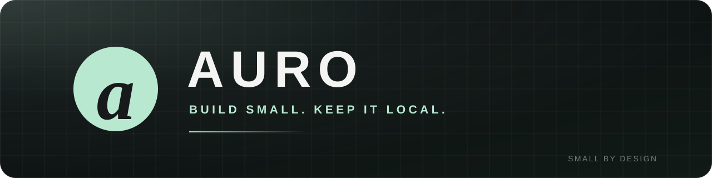

  

### Small, private tools that work without a server.

I build offline-first apps. No account, no tracking, no cloud required.

**[Moneta](https://github.com/auroflowai-design/moneta)** is a four-column personal ledger for Android and the web. Date, particulars, debit, credit — all on your device.

  

`Vanilla JavaScript` · `IndexedDB` · `Capacitor` · `Android`

Currently building Moneta. Feedback and issues are welcome.
